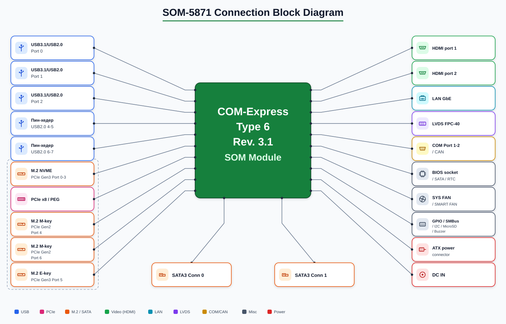

# 10-дюймовый homelab-компьютер на SOM-5871

## Общая концепция

Несущая плата (carrier board) под модуль **Advantech SOM-5871** (COM Express Basic
Type 6) на базе AMD Ryzen Embedded V1000. Планируется поддержка большинства
интерфейсов модуля: видео (dual-channel LVDS + DisplayPort), сетевой GbE,
хранилища (M.2 NVMe + 2× внешний SATA), USB 2.0/3.1, системные шины (SMBus, I2C, SPI) и
управление (WDT, FAN, RST, GPIO) — все управляющие линии сведены в один общий
(backshell) пин-хедер.

## Технические характеристики модуля SOM-5871 (база — SOM-5871VC-U0A1)

| Параметр | Характеристика |
| --- | --- |
| Процессор | AMD Ryzen Embedded V1605B (опции: V1807B, V1756B, V1404I, V1202B) |
| Ядер / потоков | 4 / 8 |
| Частота | 2.0 ГГц, Boost до 3.6 ГГц |
| TDP | 12–25 Вт (настройка 15 Вт по умолчанию) |
| ОЗУ | 2× DDR4 SO-DIMM, до 32 ГБ, ECC / Non-ECC, до 2400 МТ/с |
| Графика | Vega (до 11 CU), H.265 decode/encode, VP9 decode |
| Дисплеи | VGA, dual-channel LVDS (до 1920×1200), 2–3× DisplayPort 1.4 / HDMI 1.4 / DVI (4 независимых дисплея) |
| PCIe | 1× PEG x8 (C/D) + GPP (A/B): **6 линий (до 6 устройств)** — ревизии до ECOM-165390 (с PCIe-мостом PLX PEX8605); **5 линий (до 4 устройств)** — после ECOM-165390 (линии напрямую от chipset). Какой вариант — по ревизии модуля |
| SATA | 2× SATA III (6 Гбит/с) |
| USB | 2× USB 3.1 Gen2, 1× USB 3.1 Gen1, 8× USB 2.0 (4 от CPU + 4 от хаба) |
| Ethernet | Intel I210-AT, 10/100/1000 Мбит/с |
| COM / CAN | 2× RS-232 (COM2 — опционально с CAN) |
| Системные шины | SMBus, I2C, SPI (BIOS), LPC, 8-bit GPIO |
| Прочее | TPM 2.0 (опция), WDT 0–65535 с, 1× Smart Fan на модуле |
| Питание | ATX: Vin 8.5–20 В + VSB 4.75–5.25 В; AT: Vin |
| Габариты | 125 × 95 мм (COM Express Basic) |

## Интерфейсы модуля и их реализация на несущей плате

Количество на модуле — по блок-схеме спецификации
([`docs/SOM-5871/datasheet/SOM_5871_specification.pdf`](../docs/SOM-5871/datasheet/SOM_5871_specification.pdf),
стр. 2). «—» в столбце несущей платы = не выведен / не поддерживается.

### Сторона A/B

| № | Интерфейс | Кол-во на модуле | Кол-во на несущей плате |
|:-:|:----------|:-:|:------------------------|
| 1 | VGA | 1 | — (не поддерживается) |
| 2 | Dual Channel LVDS | 1 | 2× FPC-40 |
| 3 | HD Audio | 1 | 1× стандартный пин-хедер (как на материнских платах) |
| 4 | USB 2.0 (CPU) | 4 | 2× USB 3.1 Type-A (по 2 порта, объединённые с SuperSpeed) + 2× стандартных пин-хедера (как на материнских платах) |
| 5 | USB 2.0 (хабы на модуле) | 4 | — (хабы не поддерживаются; их порты не выводятся) |
| 6 | SATA III | 2 | 2× SATA (угловые) + 2× Molex 4-pin — питание (для подключения двух внешних дисков SATA) |
| 7 | PCIe GPP (Connector A/B) | 6 линий (до 6 устройств) — ревизии до ECOM-165390; 5 линий (до 4 устройств) — после (см. [ECOM-165390](../docs/SOM-5871/product-change/Advantech_Corporation_13256_ECOM_165390__SOM_5871_PCIe_Bridge_EOL_v1.0_20200810_1.pdf)) | 4× M.2 (см. ниже): |
| 7.1 | M.2 M-Key (NVMe) | Gen3 x4 (Port 0–3) | 1× M.2 M-Key (NVMe) |
| 7.2 | M.2 M-Key (NVMe) | Gen2 x1 (Port 4) | 1× M.2 M-Key (NVMe) |
| 7.3 | M.2 M-Key (NVMe) | Gen2 x1 (Port 6) | 1× M.2 M-Key (NVMe) |
| 7.4 | M.2 E-Key (NVMe) | Gen3 x1 (Port 5) | 1× M.2 E-Key (NVMe) |
| 8 | GbE (I210-AT) | 1 | 1× RJ45 |
| 9 | SPI | 1 | общий пин-хедер GPIO |
| 10 | SMBus | 1 | Molex 4-pin |
| 11 | I2C | 1 | общий пин-хедер GPIO |
| 12 | WDT / FAN / RST / GPIO | 1 комплект | общий пин-хедер GPIO |
| 13 | RS-232 (COM2) / CAN (опция) | 1 | общий пин-хедер GPIO |

### Сторона C/D

| № | Интерфейс | Кол-во на модуле | Кол-во на несущей плате |
|:-:|:----------|:-:|:------------------------|
| 14 | PEG #0–7 (PCIe x8) | 8 линий | 1× MCIO |
| 15 | DP1 | 1 | 1× DisplayPort |
| 16 | DP2 | 1 | — (не поддерживается) |
| 17 | DP3 | 1 | — (не поддерживается) |
| 18 | USB 3.1 (2× Gen2 + 1× Gen1) | 3 | 3× Type-A (2× угловые, вертикальные; 1× Gen1 — с портом USB 2.0, stacked-разъём по аналогии с USB3.2_1 на SOM-DB5830) |

### Примечания

- **SATA III — внешние диски**: оба порта SATA III выведены на 2× угловые
  SATA-разъёма + 2× разъёма питания Molex 4-pin (по сигнальному и
  питающему на каждый диск) — подключение двух внешних дисков SATA.
- **Общий пин-хедер GPIO**: единый послевокмальный хедер собирает SPI, I2C,
  SMBus-линии (кроме Molex), WDT, FAN, RST, GPIO (8-bit) и COM2/CAN.
- **USB** (по аналогии с SOM-DB5830, листы 6–10): из 8 портов USB 2.0 CPU
  выведены 4 (USB 2-3 — не выведены):

  | USB 2.0 (CPU) | Пины COMe | USB 3.1 (SuperSpeed) | Пины COMe | Реализация на несущей плате |
  |:--------------|:----------|:---------------------|:----------|:----------------------------|
  | USB 0-1 | A45-A46, B45-B46 | Port 0/1 (Gen2) | `SSTX/SSRX0/1`, C3-C10, D3-D10 | 2× угловых вертикальных Type-A (аналог USB3_STACKED A/B на SB-COMEX — P6A/P7A) |
  | USB 2 | A42-A44, B42-B43 | Port 2 (Gen1) | `SSTX/SSRX2`, C9-C13, D9-D13 | 1× Type-A (с портом USB 2.0) — stacked-разъём USB 3.1 (аналог USB3.2_1 на SOM-DB5830, лист 7: SS TX/RX 5 Gbps + VBUS/D-/D+/GND, LDO, CMC, ESD, OC) |
  | USB 3 | B42-B43 | — (Port 3 — N/A на модуле) | — | не выведен |
  | USB 4-5 | A39-A40, B39-B40 | — | — | 1× стандартный пин-хедер (аналог USB 2.0 (4,5) на SB-COMEX, лист 9) |
  | USB 6-7 | A36-A38, B36-B37 | — | — | 1× стандартный пин-хедер |

- **DP2/DP3 и VGA** не поддерживаются — освобождаемые линии могут быть
  задействованы под дополнительные интерфейсы (не запланировано).
- **PEG x8 (MCIO)** — линия расширения, на несущей плате не раскрывается
  под отдельные слоты.
- Механическая спецификация Basic Module (габариты, крепление, разъёмы
  COM Express несущей платы) — [mech/README.md](mech/README.md).
- Pinout всех 440 пинов разъёма (сигналы модуля SOM-5871 A101-3 + сводка по
  группам для несущей платы) — [pinout.md](pinout.md).
- Электрическая спецификация (питание 12V/5V_SBY/RTC, power sequencing,
  rise time, целостность сигналов) — [elec/README.md](elec/README.md).
- Подключение HDMI к DDIx (пин-аут Table 13, разводка TMDS Table 20,
  level shifters, ESD) — [ddi-hdmi-guide.md](ddi-hdmi-guide.md).

## Подключение HDMI

Подробное описание подключения HDMI к DDIx (пин-аут, разводка TMDS,
level shifters, ESD, пример из SB-COMEX) — [ddi-hdmi-guide.md](ddi-hdmi-guide.md).
