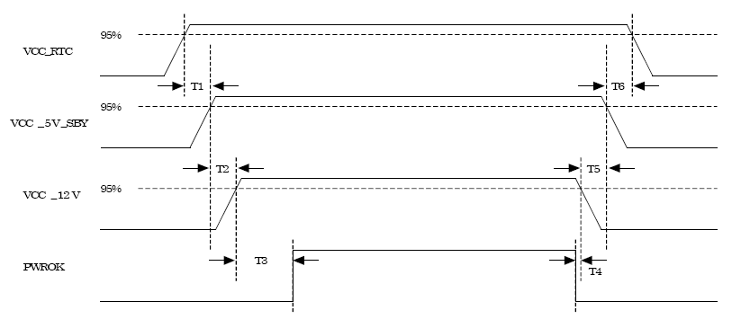
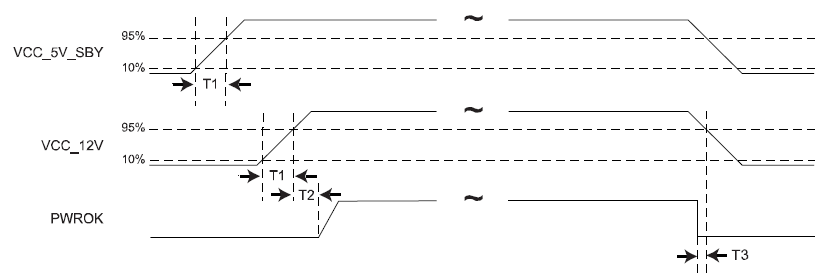

# SOM-5871 — Электрическая спецификация

Источник: вкладка *Electrical Specifications* из
[`docs/SOM-5871/SOM-5871 A101-3 COME Layout Checklist V1.01 20200604.xlsx`](../docs/SOM-5871/SOM-5871%20A101-3%20COME%20Layout%20Checklist%20V1.01%2020200604.xlsx)
(общая для COM Express Type 6; SOM-5871 — 440-pin модуль).

## Вводное питание

- Единственная основная шина — **+12 В** (номинал).
- **+5 В standby (VCC_5V_SBY)** — может быть не подключена на несущей плате,
  если standby-функции не требуются.
- **+3 В батарея (VCC_RTC)** — питает RTC при отсутствии остальных источников;
  может быть оставлена незаземлённой, если RTC без питания не требуется.
- Переключение +5 В (non-standby) ATX-блока под модуль **не используется**
  (может применяться для остального оборудования несущей платы).

Ограничения по току на пинах разъёма (Pin-out Type 2–56, 440 pin — актуально
для SOM-5871):

| Шина | Ток пина (А) | Номинал (В) | Диапазон входа (В) | Derated вход (В) | Макс. пульсации (мВ) | Макс. входная мощность (Вт) | КПД конверсии | Макс. мощность нагрузки (Вт) |
|:-----|:------------:|:-----------:|:------------------:|:----------------:|:--------------------:|:---------------------------:|:--------------:|:----------------------------:|
| VCC_12V | 16,5 | 12 | 11,4–12,6 | 11,4 | ±100 | 188 | 85 % | 160 |
| VCC_5V_SBY | 2 | 5 | 4,75–5,25 | 4,75 | ±50 | 9 | — | — |
| VCC_RTC | 0,5 | 3 | 2,0–3,3 | — | ±20 | — | — | — |

## Последовательность включения (power sequencing)

- VCC_RTC — включается одновременно с VCC_5V_SBY или раньше.
- VCC_5V_SBY — одновременно с VCC_12V или раньше.
- PWR_OK — активен одновременно с VCC_12V или позже.
- Падение: PWR_OK сбрасывается одновременно с VCC_12V или раньше;
  VCC_12V — одновременно с VCC_5V_SBY или раньше; VCC_5V_SBY — одновременно
  с VCC_RTC или раньше.

| Т | Интервал | Требование |
|:-:|:---------|:-----------|
| T1 | включение VCC_RTC → включение VCC_5V_SBY | ≥ 0 мс |
| T2 | включение VCC_5V_SBY → включение VCC_12V | ≥ 0 мс |
| T3 | включение VCC_12V → PWR_OK | ≥ 0 мс |
| T4 | сброс PWR_OK → сброс VCC_12V | ≥ 0 мс |
| T5 | сброс VCC_12V → сброс VCC_5V_SBY | ≥ 0 мс |
| T6 | сброс VCC_5V_SBY → сброс VCC_RTC | ≥ 0 мс |

## Время нарастания питающих напряжений

VCC_12V и VCC_5V_SBY (если используется) должны нарастать с ≤ 10 % номинала
до рабочего диапазона за **0,1–20 мс** (0,1 мс ≤ T1 ≤ 20 мс):

- плавный непрерывный фронт 10–90 % в пределах рабочего диапазона;
- на участке 10–90 % наклон положительный: от 0 В/мс до [Vout,nom / 0,1] В/мс;
- на любом участке 5 мс внутри фронта 10–90 % наклон ≥ [Vout,nom / 20] В/мс.

T2 ≥ 0 мс, T3 ≥ 0 мс. Значения подобраны для совместимости с ATX R2.2.

## Требования к целостности сигналов

Для проектирования модуля и несущей платы учесть следующие группы сигналов
(полные требования — в соответствующих спецификациях интерфейсов):

| Группа сигналов | Описание | Источник |
|:----------------|:---------|:---------|
| Аналоговый VGA | 75 Ом, однополярные относительно GND; рекомендуется обильная изоляция | — |
| Компонентное/композитное видео | 75 Ом, однополярные относительно GND; рекомендуется обильная изоляция | — |
| Gigabit Ethernet | дифференциальные пары | IEEE 802.3 |
| LVDS | 100 Ом, edge-coupled дифференциальные пары | National Semiconductor LVDS |
| PCI Bus | ~60 Ом, однополярные | PCI SIG, PCI Local Bus Spec Rev. 2.3 |
| Часы PCI/LPC | 50 Ом, однополярные относительно GND | — |
| PCI Express | дифференциальные пары | PCI SIG, PCI Express Specification |
| Часы PCI Express | 100 Ом, edge-coupled дифференциальная пара, относительно GND | — |
| Serial ATA | дифференциальные пары | SATA Specification |
| USB | дифференциальные пары | USB 2.0 Specification |

> **Примечание:** VGA на SOM-5871 не выводится на несущую плату
> (см. [../pinout.md](../pinout.md), сводку по группам) — требования по VGA
> актуальны только для модуля.
