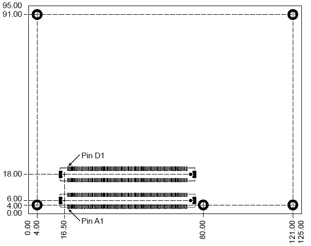
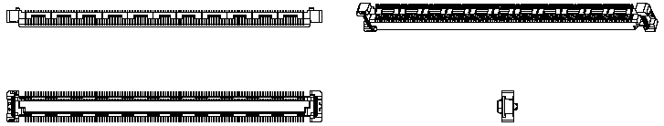
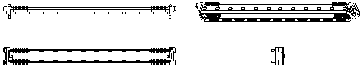
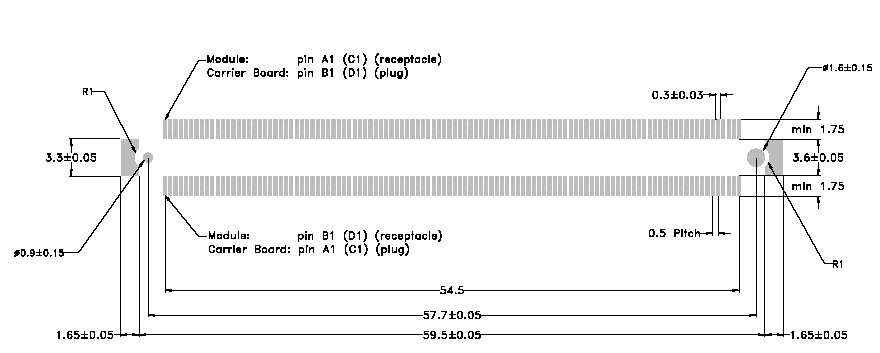
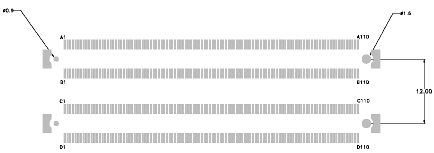
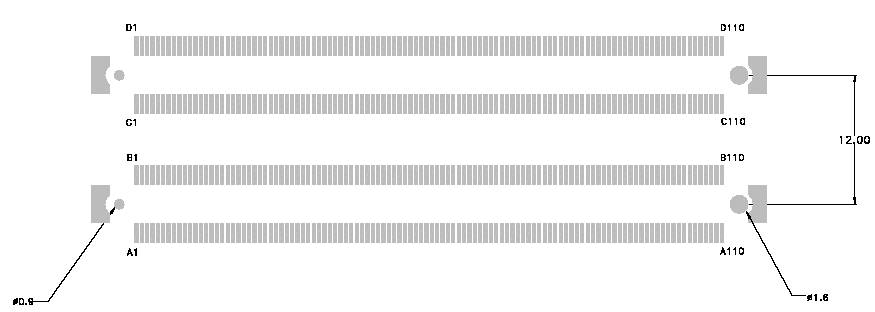

# SOM-5871 — Механическая спецификация (Basic Module)

Источник: вкладка *Mechanical Specifications* из
[`docs/SOM-5871/SOM-5871 A101-3 COME Layout Checklist V1.01 20200604.xlsx`](../docs/SOM-5871/SOM-5871%20A101-3%20COME%20Layout%20Checklist%20V1.01%2020200604.xlsx).

Перенесена только информация, относящаяся к **Basic Module** (125 × 95 мм) и
**несущей плате** (carrier board): габариты, крепление, разъёмы COM Express.
Форм-факторы Compact (95 × 95 мм) и Extended (155 × 110 мм) намеренно
пропущены.

## Габариты модуля

| Параметр | Значение |
| --- | --- |
| Форм-фактор | COM Express **Basic Module** |
| Размер PCB | 125 × 95 мм |
| Толщина PCB | 2 мм (для многослойных stack-up, стандартный «z»-размер между carrier board и верхом heat-spreader) |
| Точность размеров | ±0,25 мм (±0,010"), если не указано иное |
| Разъём | 440-pin (2 × 220-pin, шаг 0,5 мм), установлен **на обратной стороне** PCB |
| Отверстия крепления модуля к несущей плате | **5 шт.**: контакт (pad) ⌀ 6 мм, гальваническое отверстие ⌀ 2,7 мм, крепёж 2,5 мм; pads соединены с землёй PCB |
| Охлаждение | Heat-spreader крепится к модулю отдельным набором отверстий/прокладок, специфичным для реализации |

## Разъём модуля (модульная сторона — для справки)

На модуле — **440-pin гнездо (receptacle)**, собранное из двух 220-pin
гнездовых частей (шаг 0,5 мм, высота 4H). Квалифицировано для LVDS до 6,25 ГГц
(PCIe Gen2).

| Производитель | 220-pin 4H Receptacle | 440-pin 4H Receptacle (2 × 220) |
| --- | --- | --- |
| AMP / Tyco | 3-1318490-6 | 3-1827231-6 |
| Foxconn | QT012206-1031-2H | QT012206-1041-3H |
| эквивалент | шаг 0,5 мм, 220 pin, 4H | шаг 0,5 мм, 440 pin, 4H |

## Разъём несущей платы (carrier board)

На несущей плате — **440-pin штекер (plug)** из двух 220-pin частей (шаг 0,5 мм).
Квалифицировано для LVDS до 6,25 ГГц (PCIe Gen2). Высота стека: **5 мм или 8 мм**.

### Варианты 220-pin штекера

| Высота стека | AMP / Tyco | Foxconn | Примечание |
| :-: | --- | --- | --- |
| 5 мм (5H) | 3-1827253-6 | [QT002206-2131-3H](../../bom/connectors/comexpress/QT002206-2131-3H.pdf) (LCSC C2761498) | [даташит в BOM](../bom/connectors/comexpress/3-1827253-6.pdf) |
| 8 мм (8H) | 3-1318491-6 / 8-1318491-6 (с anti-wicking) | [QT002206-4131-3H](../../bom/connectors/comexpress/QT002206-4131-3H.pdf) (LCSC C2761499) | |

### Варианты комбинированного 440-pin штекера (2 × 220 на carrier)

| Высота стека | AMP / Tyco | Foxconn | Примечание |
| :-: | --- | --- | --- |
| 5 мм (5H) | 3-1827233-6 | QT002206-2141-3H | |
| 8 мм (8H) | 3-5353652-6 | QT002206-4141-3H | |

> **Примечания:**
> - артикул с ведущей «8» (8-1318491-6) — то же исполнение с anti-wicking
>   покрытием, полезным при агрессивных флюсах; у вендоров доступно по запросу;
> - «receptacle» / «plug» — терминология вендора; визуально 440-pin штекер
>   несущей платы похож на гнездо.

## Разводка под разъём (PCB pattern)

Все размеры в мм.

**Модульная сторона (receptacle, 440 pin):**

**Сторона несущей платы (plug, 440 pin):**

## Нумерация пинов разъёма несущей платы

Вид сверху, внутрь штекера, установленного на несущей плате.

